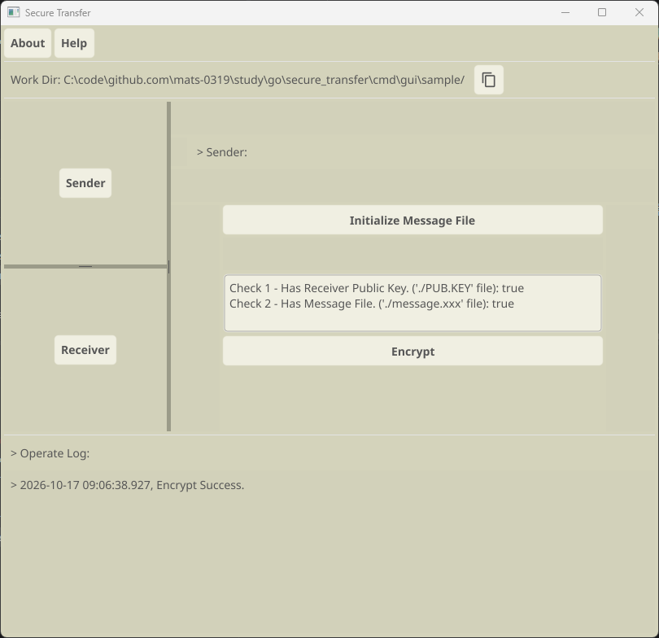

# 安全的信息传输工具 Secure Message Transfer Tool

本工具可以让两个人在不安全的通信信道上，以文件为载体，安全的传递信息

## 使用

> 以命令行程序使用，参考：`/cmd/cli/script/manual.md`
> 以图形化界面程序使用，参考：`/cmd/gui/components/utils.go helpText`

> 我们会提供一些平台的可执行程序，但我们建议你阅读源代码后自行编译。

> 声明：`/cmd/cli/sample/`路径下的私钥等文件仅作为演示使用

程序会在当前目录创建和读取文件，请在一个单独的路径中启动程序。

编译：以命令行形式使用无需外部依赖 (go install)，以GUI形式使用需要安装依赖

- fyne存在交叉编译问题：仅根据文档中要求下载的内容，无法在linux上编译windows的可执行程序，所以gui的编译脚本也仅供参考

[下载go、C编译器和系统显卡驱动程序](https://docs.fyne.io/started/quick/)

```cmd
go get fyne.io/fyne/v2@latest
go install fyne.io/tools/cmd/fyne@latest
```

### GUI

fyne依赖cgo，如果编译环境和你的系统的glibc版本不兼容，则可执行程序无法使用。  
因此我们提供的gui的二进制文件在你的设备上无法运行是有可能的，附使用截图。




## 技术准备

[见tech_prepare.md](doc/tech_prepare.md)

## 技术细节

[见design.md](doc/design.md)

## 开发计划

- 优化流式加密性能：根据基准测试结果，当前流式加密代码分配内存比直接读取全文还多，尝试优化它

## 测试

代码在`test/`，包括一次性加密和流式加密的功能测试与基准测试，以下是基准测试结果：

```cmd
$ go test -bench=. -benchmem  # 同时执行普通测试，保证功能正确性
goos: linux
goarch: amd64
pkg: github.com/mats0319/secure_transfer/test
cpu: AMD Ryzen 7 7700 8-Core Processor              
BenchmarkEncryptSameFile/Encrypt_Once-16                       1        1338428994 ns/op        2147507752 B/op       41 allocs/op
BenchmarkEncryptSameFile/Encrypt_Stream-16                     2         634281066 ns/op        3249607472 B/op     5207 allocs/op
PASS
ok      github.com/mats0319/secure_transfer/test        6.276s
```
